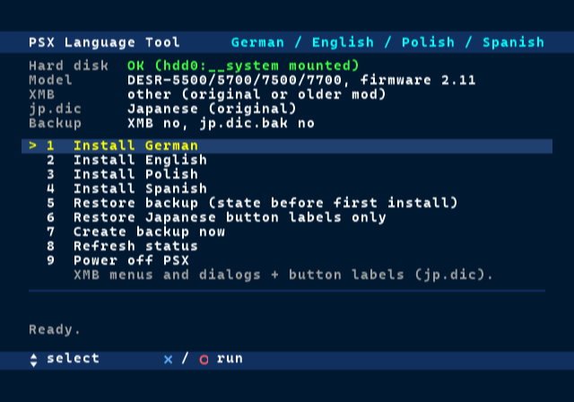
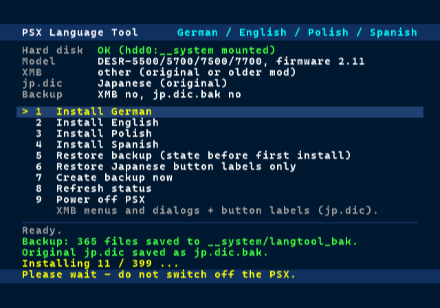
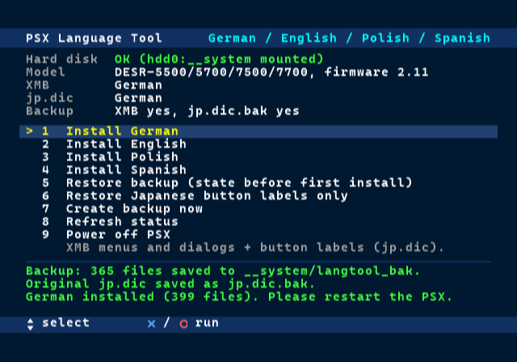

# PSX Language Tool

German, English, Polish and Spanish translations of the XMB for the Sony PSX (DESR), plus an
installer ELF that runs on the PSX itself.

The repository contains **no Sony files** - only translation tables, scripts and the
ELF source. The language folders and the ELF are built from your own copies of the
source files.

## Screenshots

`PSX_LANGUAGE_TOOL.ELF` on a DESR-5500 (rendered by the PC host test from the same image the tool sends to the
TV):

| Main menu | Confirmation |
|---|---|
|  |  |
| **Installing (backup first)** | **Done** |
|  |  |

## Building

1. Download the EN package `PSX_SystemFiles_EN_v1.3_Final.zip` of
   [RepairBox-PSX-HDD-Setup](https://github.com/DanielFergisz/RepairBox-PSX-HDD-Setup)
   (linked in its README) and put it into `sources/` (ignored by git). Only its
   original PSX system files are used (`RepairBox-PSX1/PSX2-SystemFiles/__system`).
2. `python tools/build_all.py` - builds the language folders and checks every file
   against `tools/expected.sha1`.
3. Put the ps2dev v2.0.0 Windows toolchain into `tools/ps2dev`, then
   `sh tools/elf/build.sh` (Git Bash) - builds `ELF-INSTALLER/PSX_LANGUAGE_TOOL.ELF`.

Result:

| Folder | Content |
|---|---|
| `DESR-5000-5100-7000-7100 XMB GER/ENG/POL/ESP` | XMB files for firmware 1.31 (`xosd/packages/...` on `hdd0:__system`) |
| `DESR-5500-5700-7500-7700 XMB GER/ENG/POL/ESP` | XMB package folders for firmware 2.11 (`hdd0:__system/xosd/packages/`) |
| `SYSTEM-DIC GER/ENG/POL/ESP` | button labels `hdd0:__system/dic/jp.dic` (5500 series) |
| `ELF-INSTALLER/PSX_LANGUAGE_TOOL.ELF` | installs everything with backup/restore, see `ELF-INSTALLER/README.txt` |

## In the repository

| Path | Content |
|---|---|
| `tools/translation` | `eng5000.patch`, `eng5500.patch` (English texts as a patch for the original files - only the new texts, no Sony text), `de*.tsv`, `pl*.tsv`, `es*.tsv` and the scripts that apply them |
| `tools/sysdic` | builds the button-label `jp.dic` files |
| `tools/elf` | ELF source (`gui.c`), pack/check scripts, font generator, PC host test |
| `tools/build_all.py`, `tools/expected.sha1` | full build and its reference checksums |

## Testing on the PC

`tools/elf/hosttest` compiles `gui.c` for Windows (MSYS2 i686 gcc + zlib) with stubs for
the PS2 libraries and runs install / backup / restore scenarios against copies of the
package's `__system` folders (`run.py`, uses `build/package` from `build_all.py`).
Set `SCRSHOT` to save every screen as PPM.

## Credits

- PSX system files (base for all languages):
  [RepairBox-PSX-HDD-Setup](https://github.com/DanielFergisz/RepairBox-PSX-HDD-Setup)
  by DanielFergisz (RepairBox.pl)
- English texts: based on the English community XMB mods, cleaned up
- Font: Cascadia Mono (SIL Open Font License)
- Toolchain: [ps2dev](https://github.com/ps2dev/ps2dev), gsKit, zlib

The built folders and the ELF contain Sony-derived files - keep them for private use.
